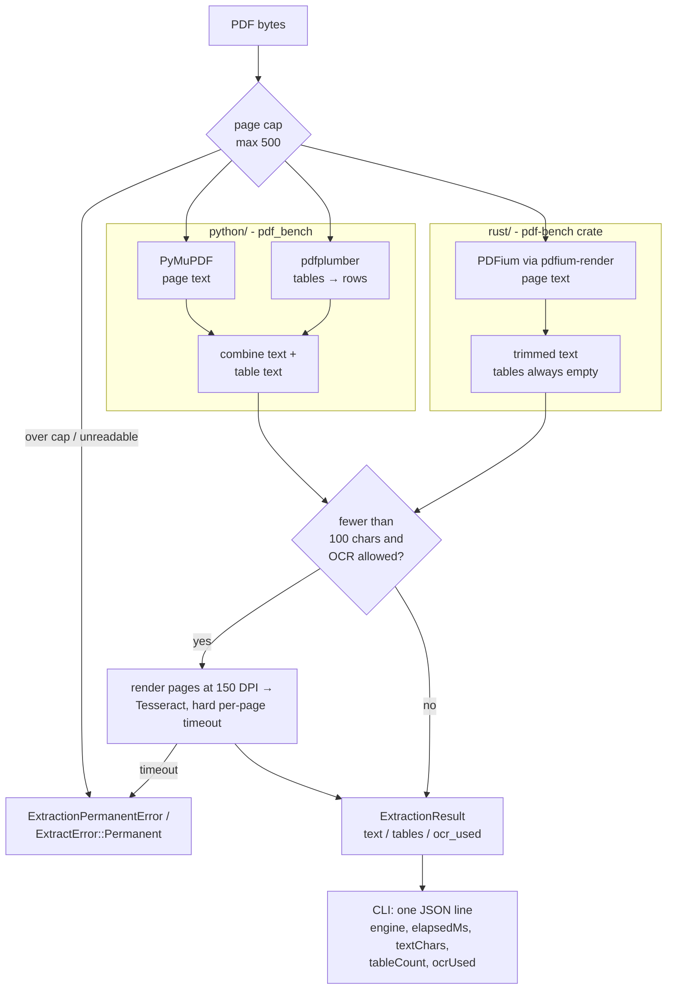

# pdf-bench

The same PDF extraction pipeline written twice, in Python (PyMuPDF +
pdfplumber + optional Tesseract OCR) and in Rust (PDFium + optional Tesseract
OCR), with one output contract and a benchmark script that runs both against
the same file.

## Why this exists

A freight back office runs on PDFs: rate confirmations, bills of lading,
invoices. The production extraction worker was Python, and the question was
whether a Rust port was worth the build and deploy cost. Answering that
honestly needs both implementations behind the same contract, the same error
taxonomy, and the same fixture. This repo is that comparison, extracted from a
production trucking operations platform with the queue and storage glue
removed.

## Architecture



Key decisions and tradeoffs:

- **Same contract, deliberately different scope.** Both paths return
  `text / tables / ocr_used` and print the same JSON line, so the benchmark
  compares like with like. The Rust path skips structured tables on purpose: it
  measures text-extraction speed, which is what the port would replace.
- **Permanent vs retryable errors are part of the contract.** Malformed PDFs,
  page-cap overruns, and OCR timeouts are permanent (do not retry the job); a
  missing PDFium library or a page render failure is retryable (an environment
  problem, not a bad document). A queue consumer needs that split to avoid
  retry storms on poison messages.
- **OCR is a fallback, not a pass.** OCR only runs when the text layer yields
  fewer than 100 characters, i.e. a scanned document. Both paths shell out to
  Tesseract with a hard per-page timeout; Rust kills the child on overrun.
  Non-timeout OCR failures degrade to empty text (Rust logs them via
  `tracing` instead of swallowing them silently).
- **PDFium runs one-shot.** `Pdfium` wraps a non-thread-safe FFI library, so
  `Engine` is `!Send` and the binary handles one file per process. A PDFium
  segfault kills one child process, not a worker pool.
- **PDFium is loaded dynamically and pinned.** `PDFIUM_DYNAMIC_LIB_PATH` (a
  directory or the library file) wins, otherwise the system library path is
  searched. `scripts/fetch-pdfium.sh` pins build 7543, the ABI pdfium-render
  0.8.37 targets, and checks its SHA-256.

## Quick start

Requires Python 3.11+, a Rust toolchain, `curl`, and `make`. Tesseract is
optional (only used for the OCR fallback; the benchmark passes `--no-ocr`).

```bash
make setup          # python/.venv with the package + dev extras
make pdfium         # prebuilt PDFium 7543 into ./.pdfium (checksum-verified)
make test           # pytest + cargo test
make bench          # 5 runs each against fixtures/sample.pdf, then a summary table
make fixtures-long  # 1/10/100/500-page packets into fixtures/generated/ (gitignored)
make bench-scaling  # both engines across that ladder (takes about 10 minutes)
```

Or the raw commands:

```bash
python3 -m venv python/.venv
python/.venv/bin/pip install -e "python[dev]"
eval "$(scripts/fetch-pdfium.sh)"          # exports PDFIUM_DYNAMIC_LIB_PATH

(cd python && .venv/bin/python -m pytest -q)
cargo test --manifest-path rust/Cargo.toml

scripts/benchmark.sh                        # or: scripts/benchmark.sh /path/to/other.pdf
RUNS=10 scripts/benchmark.sh                # more runs
scripts/benchmark.sh --scaling fixtures/generated   # one row per file; RUNS_LARGE for >= 500 pages
```

Single runs:

```bash
(cd python && .venv/bin/python -m pdf_bench.cli ../fixtures/sample.pdf --no-ocr)
cargo run --release --quiet --manifest-path rust/Cargo.toml -- fixtures/sample.pdf --no-ocr
```

### Generating test PDFs (including very long ones)

[`scripts/generate_pdfs.py`](scripts/generate_pdfs.py) generates synthetic
trucking paperwork with reportlab, deterministically from `--seed`:

| `--kind` | What it looks like |
| --- | --- |
| `rate-confirmation` | Broker-to-carrier tender: parties, stop schedule, rate table, accessorial schedule, terms, signatures |
| `bill-of-lading` | Shipper / consignee / carrier block, commodity lines (HU, class, NMFC, weight), contract terms, totals |
| `invoice` | Freight bill: line items, accessorial charges, payment terms, summary and remittance stub |
| `settlement` | Driver pay statement: trip earnings, deductions, reimbursements, policy notes, YTD totals |
| `mixed` (default) | A load packet: the four kinds above interleaved back to back, like a scanned packet |
| `load-confirmation` | The original fixture layout (used by `--fixture`) |

Long documents are really long: line-item tables continue across pages with
the header row repeated, followed by accessorial tables, stop lists, and
terms-and-conditions prose, under a running header and a `Page x of N` footer
(a packet also prints `Packet page x of N`). `--pages N` gives exactly N pages
(1 to 5000). The same arguments give the same bytes, since reportlab runs with
`invariant=1`. Every company, person, and number is obviously fake: "Sample
Carrier LLC", `MC-000000`, `USDOT 0000000`, state `ZZ`, ZIP `00000`, "Jordan
Q. Testdriver", `example.com`. PDF Author and Creator are `pdf-bench`.

```bash
GEN="python/.venv/bin/python scripts/generate_pdfs.py"

$GEN --kind mixed --pages 1000 --seed 7 --out /tmp/packet-1000p.pdf      # ~2.5 MB, ~8 s
$GEN --kind invoice --pages 1000 --out /tmp/invoice-1000p.pdf            # ~3.2 MB, ~10 s
$GEN --kind settlement --pages 3 --count 20 --seed 100 --out-dir /tmp/batch   # 20 files, seeds 100..119
$GEN --kind bill-of-lading --pages 5 --scanned --out /tmp/bol-scanned.pdf     # image-only pages
$GEN --fixture                                                            # rewrites fixtures/sample.pdf
```

`--scanned` rasterizes each page to a grayscale JPEG (150 DPI by default,
`--scan-dpi` to change) and rebuilds the PDF with no text layer, so the OCR
fallback actually runs. It is optional because it is expensive: about 0.2 s and
190 KB per page at 150 DPI (a 1000-page scanned packet is about 190 MB), and
OCR on it then costs seconds per page.

Both extractors cap documents at 500 pages (`--max-pages` on the Python CLI;
fixed in the Rust binary), as production did, so a 1000-page file is rejected
as a permanent error. That is the intended behaviour; use it to test the cap,
or raise the cap to benchmark beyond 500.

### The fixture

`fixtures/sample.pdf` is a 10-page synthetic load confirmation (a stop table,
a rate table, and a terms block per page). It is the `load-confirmation` kind
of the same generator, and `make fixture` (`generate_pdfs.py --fixture`)
reproduces the committed file byte for byte. A test checks this.

## Results

`scripts/benchmark.sh` on `fixtures/sample.pdf`, 5 runs each, `--no-ocr`.

Machine: **CI container** (2 vCPU Intel Xeon @ 2.80GHz, Linux x86_64), Python
3.13, PyMuPDF 2.0, pdfplumber 0.11.10, Rust 1.97 release build, PDFium 7543.

| Engine | Runs | Median ms | Min ms | Max ms | Text chars | Tables |
| --- | ---: | ---: | ---: | ---: | ---: | ---: |
| python | 5 | 1123.29 | 1059.85 | 1350.04 | 25340 | 20 |
| rust | 5 | 31.06 | 14.82 | 63.20 | 20414 | 0 |

Reading it honestly:

- The headline gap is mostly **pdfplumber**, not Python. Timed separately on
  the same file, PyMuPDF text extraction alone has a median of about 27 ms and
  pdfplumber table extraction about 1,420 ms. Rust text-only (31 ms, including
  loading PDFium) is in the same range as PyMuPDF text-only.
- Python's `textChars` is higher because it appends the extracted tables as
  pipe-delimited rows; Rust returns the page text only.
- The Python timer starts after interpreter start-up and imports; the Rust
  timer includes binding PDFium. Process start-up is excluded from both.
- So the real decision is "do we need structured tables on this path?" If not,
  dropping pdfplumber gets most of the speed without a port. If yes, the Rust
  path would need its own table extraction before the comparison is fair.

Numbers will vary by machine. Run `make bench` for your own.

### Scaling with document length

`make bench-scaling`: `mixed` packets (seed 1) of 1, 10, 100, and 500 pages
from `generate_pdfs.py`, `--no-ocr`, median of 5 runs (3 for the 500-page
document). Same machine as above (**CI container**).

| Pages | File size | Python median ms | Rust median ms | Python ms/page | Rust ms/page | Chars (Python / Rust) | Tables found (Python) |
| ---: | ---: | ---: | ---: | ---: | ---: | ---: | ---: |
| 1 | 3 KB | 50.5 | 6.6 | 50.5 | 6.58 | 1,788 / 1,151 | 2 |
| 10 | 29 KB | 1,574.1 | 19.7 | 157.4 | 1.97 | 56,874 / 30,831 | 9 |
| 100 | 234 KB | 9,789.7 | 108.6 | 97.9 | 1.09 | 356,501 / 197,543 | 139 |
| 500 | 1.2 MB | 54,889.3 | 614.6 | 109.8 | 1.23 | 1,859,328 / 1,096,446 | 602 |

Both paths are roughly linear in pages past the first few: Python settles
around 100 to 110 ms/page and Rust around 1.1 to 1.2 ms/page, with no sign of
superlinear blow-up at 500 pages. Per-page cost depends on content, not page
count alone (the 10-page packet happens to be one dense invoice, all full
40-row tables, so it costs more per page than the prose-heavy longer packets),
and the 1-page Rust number is mostly fixed PDFium start-up. pdfplumber still
dominates the Python time: timed separately on the 100-page packet, PyMuPDF
text is about 78 ms and pdfplumber tables about 10,200 ms. These are a handful
of runs on a shared 2-vCPU container, so treat them as noisy, order-of-
magnitude numbers.

## Tests

```bash
make test
```

- Python (3 tests, `python/tests/test_extractor_contract.py`): invalid bytes
  raise `ExtractionPermanentError`; the synthetic fixture yields the expected
  text and exactly 20 tables with the right header row; a page cap below the
  page count is a permanent error.
- Generator (25 tests, `python/tests/test_generate_pdfs.py`): the same seed
  gives the same text and bytes and a different seed gives different text;
  page count is exact for 1 to 120 pages; every kind renders text and
  pdfplumber-detectable tables; long tables repeat their header on
  continuation pages; a packet contains all four kinds; `--fixture` reproduces
  the committed fixture byte for byte; metadata and file bytes contain no
  personal names or local paths; MC/DOT numbers, states, ZIPs, and phone
  numbers are only the fake placeholders; `--scanned` output has no text layer;
  batch naming and seeding; bad CLI arguments are rejected.
- Rust (3 tests, `rust/tests/`): the same three properties against PDFium
  (tables are always empty on this path). These need PDFium; run
  `make pdfium` or set `PDFIUM_DYNAMIC_LIB_PATH` first.

CI (`.github/workflows/ci.yml`) runs the Python and generator tests and a
200-page generator smoke run, fetches PDFium and runs the Rust tests, then runs
the fixture benchmark and a small scaling smoke run (the 1- and 10-page rungs
only; the full ladder is local-only because the Python path takes minutes on
the 100- and 500-page documents).

## What was left out

The production worker around these extractors: queue consumption and retry
policy, object-storage download, tracing exporters (the Python span helpers are
kept as no-op stubs so the extractor code reads the same as production),
persistence of extracted text, and the document classification and field
parsing that run downstream. Real customer PDFs were never in this repo; only the
synthetic fixture is.


## License

MIT. See [LICENSE](LICENSE).
